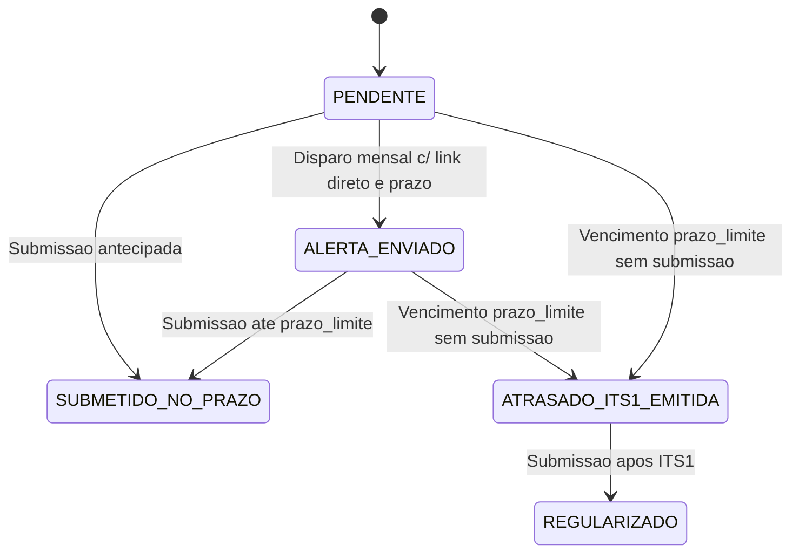

# Especificação Técnica — Prestação de Contas SEMESTRAL (QuIIN / SENAI CIMATEC - EMBRAPII v3.1)

**Repositório:** `prototipo-prest-contas` (Django 5.2.17)  
**Centro de Competência:** `QuIIN (SENAI CIMATEC)` | **Abreviação oficial:** `QIN`  
**Templates oficiais de referência (imutáveis):** `mockup/exemplos_arquivos/PREST_SEMESTRAL/`  
**Templates gerenciados para clonagem:** `templates_embrapii/v3_1/`

---

## 0. Descoberta & Grounding dos Templates EMBRAPII v3.1

Inspeção programática dos 5 arquivos oficiais confirmou:

| Tag | Arquivo Oficial v3.1 | Aba Sumário (Parâmetros) | Abas no Escopo QuIIN | Abas de Domínio | Proteções SHA-512 / XML |
|---|---|---|---|---|---|
| `FIN` | `Cópia de PPI - Acompanhamento Financeiro - Semestral (v3.1).xlsx` | `0. Sumário` (`J21`, `J22`, `J23`) | `10. Conta Ação - Outras Fontes`, `11. Equipe`, `12. Licenciamento de PIs`, `13. Acompanhamento Associadas`, `14. Cooperação Nacional`, `15. Cooperação Internacional`, `16. Mídia`, `17. Eventos`, `18. Conselho Consultivo` *(Excluídas: `0`–`9.1` e `19. Versões`)* | `Listas`, `PIs`, `Projetos` | 20 `<sheetProtection>` (11–19 SHA-512), 11 `<extLst>` (`x14:dataValidations`), comentários em células mescladas (`O21`) |
| `FCRH` | `PPI - Acompanhamento Técnico - FCRH - Semestral (v3.1).xlsx` | `1. Sumário` (`J15`, `J16`, `J17`) | `2. Info projetos FCRH`, `3. Profissionais Capacitados`, `4. Outros comentários` | `Listas` | 5 `<sheetProtection>` SHA-512, 2 `<extLst>`, comentário `O15` |
| `ACS` | `PPI - Acompanhamento Técnico - ACS - Semestral (v3.1) (2).xlsx` | `1. Sumário` (`J15`, `J16`, `J17`) | `2. Info projetos PD&I ACS`, `2.1. Pedidos de PI`, `2.2. Publicações`, `3. Info projetos Formação`, `4. Profissionais Capacitados`, `5. Empresas envolvidas`, `6. Outros comentários` | `Listas` | 9 `<sheetProtection>` SHA-512, 5 `<extLst>`, comentário `O15` |
| `AFCCT` | `PPI - Acompanhamento Técnico - AFCCT - Semestral (v3.1) (1).xlsx` | `1. Sumário` (`J15`, `J16`, `J17`) | `2. Info Projetos PD&I AFCCT`, `2.1. Pedidos de PI`, `2.2. Publicações`, `3. Info projetos Formação`, `4. Profissionais Capacitados`, `5. Outros comentários` | `Listas` | 8 `<sheetProtection>` (7 SHA-512), 6 `<extLst>`, comentário `O15` |
| `AT` | `PPI - Acompanhamento Técnico - AT - Semestral (v3.1) (1).xlsx` | `1. Sumário` (`J15`, `J16`, `J17`) | `2. Info atividades AT`, `3. Prospecção`, `4. Outros comentários` | `Listas` | 5 `<sheetProtection>` SHA-512, 2 `<extLst>`, comentário `O15` |

> **Observação de arquitetura OOXML:** `openpyxl` emite `UserWarning` e **remove** `<extLst>` (`x14:dataValidations`), comentários em células mescladas (`'0. Sumário':O21`, `'1. Sumário':O15`) e atributos `SHA-512` (`algorithmName`, `hashValue`, `saltValue`, `spinCount`) ao salvar. Por isso o motor de exportação deve preservar 100% do pacote ZIP original.

---

## 1. Arquitetura de Dados (ER / Models — App `apps.semestral`)

### 1.1 Diagrama Entidade-Relacionamento

```mermaid
erDiagram
    CicloSemestral ||--o{ CompetenciaMensalPilar : "possui 6 meses x pilares"
    ConfiguracaoPilarSemestral ||--o{ CompetenciaMensalPilar : "define responsavel e prazo"
    ConfiguracaoPilarSemestral }o--o| Pilar : "vincula RBAC"
    ConfiguracaoPilarSemestral }o--o| User : "responsavel"
    CompetenciaMensalPilar ||--o{ LogNotificacaoSLA : "auditoria e ITS1"
    CompetenciaMensalPilar ||--o{ RegFinOutrasFontes : "coleta mensal"
    CompetenciaMensalPilar ||--o{ RegFinEquipe : "coleta mensal"
    CompetenciaMensalPilar ||--o{ RegFinLicenciamentoPI : "coleta mensal"
    CompetenciaMensalPilar ||--o{ RegFinAssociadas : "coleta mensal"
    CompetenciaMensalPilar ||--o{ RegFinCoopNacional : "coleta mensal"
    CompetenciaMensalPilar ||--o{ RegFinCoopInternacional : "coleta mensal"
    CompetenciaMensalPilar ||--o{ RegFinMidia : "coleta mensal"
    CompetenciaMensalPilar ||--o{ RegFinEventos : "coleta mensal"
    CompetenciaMensalPilar ||--o{ RegFinConselho : "coleta mensal"
    CompetenciaMensalPilar ||--o{ RegFcrhProjeto : "coleta mensal"
    CompetenciaMensalPilar ||--o{ RegFcrhProfissional : "coleta mensal"
    CompetenciaMensalPilar ||--o{ RegAcsProjetoPdi : "coleta mensal"
    CompetenciaMensalPilar ||--o{ RegAcsPedidoPi : "coleta mensal"
    CompetenciaMensalPilar ||--o{ RegAcsPublicacao : "coleta mensal"
    CompetenciaMensalPilar ||--o{ RegAcsProjetoFormacao : "coleta mensal"
    CompetenciaMensalPilar ||--o{ RegAcsProfissional : "coleta mensal"
    CompetenciaMensalPilar ||--o{ RegAcsEmpresa : "coleta mensal"
    CompetenciaMensalPilar ||--o{ RegAfcctProjetoPdi : "coleta mensal"
    CompetenciaMensalPilar ||--o{ RegAfcctPedidoPi : "coleta mensal"
    CompetenciaMensalPilar ||--o{ RegAfcctPublicacao : "coleta mensal"
    CompetenciaMensalPilar ||--o{ RegAfcctProjetoFormacao : "coleta mensal"
    CompetenciaMensalPilar ||--o{ RegAfcctProfissional : "coleta mensal"
    CompetenciaMensalPilar ||--o{ RegAtAtividade : "coleta mensal"
    CompetenciaMensalPilar ||--o{ RegAtProspeccao : "coleta mensal"
    CompetenciaMensalPilar ||--o{ RegOutrosComentarios : "coleta mensal"
```

### 1.2 Entidades Principais

1. **`CicloSemestral`** (`semestral_ciclosemestral`):
   - `ano` (`PositiveIntegerField`), `semestre` (`PositiveSmallIntegerField`, choices `1 | 2`), `unique_together=(ano, semestre)`
   - `centro_competencia` (`CharField`, default `"QuIIN (SENAI CIMATEC)"`)
   - `abreviacao_cc` (`CharField`, default `"QIN"`)
   - `termo_cooperacao` (`CharField`, default `"001/2023"`)
   - `periodo_referencia_label` (`CharField`, ex.: `"1º semestre/2026"` / `"2º semestre/2026"`)
   - `status` (`ABERTO`, `CONSOLIDADO`, `ENVIADO`)
   - `coordenacao_nome` (`CharField`, default `"Mabel"`)
   - `coordenacao_email` (`EmailField`, default `"mabel.gestao@quiin.local"`)
   - `criado_em`, `atualizado_em`

2. **`ConfiguracaoPilarSemestral`** (`semestral_configuracaopilar`):
   - `codigo` (`unique`: `FCRH`, `ACS`, `AFCCT`, `AT`, `FIN_QUIIN`)
   - `nome` (`CharField`)
   - `arquivo_embrapii` (`FIN`, `FCRH`, `ACS`, `AFCCT`, `AT`)
   - `pilar` (`ForeignKey(pillars.Pilar, null=True, blank=True)`)
   - `responsavel` (`ForeignKey(accounts.User, null=True, blank=True)`)
   - `responsavel_nome` (`CharField`)
   - `responsavel_email` (`EmailField`)
   - `dia_limite_mensal` (`PositiveSmallIntegerField`, default `5` — 5º dia do mês subsequente à competência, ajustável)
   - `ordem` (`PositiveSmallIntegerField`), `ativo` (`BooleanField`, default `True`)
   - **Nota:** `FIN_QUIIN` cobre a aba verde `10. Conta Ação - Outras Fontes` e as abas azuis `11. Equipe` até `18. Conselho Consultivo`.

3. **`CompetenciaMensalPilar`** (`semestral_competenciamensalpilar`):
   - `ciclo` (`FK CicloSemestral`), `configuracao_pilar` (`FK ConfiguracaoPilarSemestral`)
   - `competencia` (`DateField` — sempre dia 01 do mês, `mm/aaaa`)
   - `prazo_limite` (`DateTimeField`)
   - `token_acesso` (`UUIDField(default=uuid.uuid4, unique=True)`) — usado no link direto contextualizado
   - `status` (`PENDENTE`, `ALERTA_ENVIADO`, `SUBMETIDO_NO_PRAZO`, `ATRASADO_ITS1_EMITIDA`, `REGULARIZADO`)
   - `alerta_inicial_em`, `submetido_em`, `its1_emitida_em`, `regularizado_em` (`DateTimeField(null=True)`)
   - `submetido_por` (`FK User, null=True`)
   - `observacao_submissao` (`TextField(blank=True)`)
   - `unique_together=(ciclo, configuracao_pilar, competencia)`

4. **`ListaDominioEmbrapii`** (`semestral_listadominio`):
   - `categoria` (`CharField`, indexado: ex. `CC_NOMES`, `OUTRAS_FONTES_ELEMENTO_AT`, `EQUIPE_TITULACAO`, `EQUIPE_FUNCAO`, `ASSOCIADA_CARGO`, `CONSELHO_REPRESENTACAO`, `CONSELHO_NIVEL`, `PROJETO_STATUS`, `PI_TIPO`, `PUBLICACAO_CLASSIFICACAO`, `PROSPECCAO_CARGO`, etc.)
   - `arquivo_origem`, `aba_origem`, `referencia_celula`
   - `valor` (`CharField(255)`), `codigo_auxiliar` (`CharField(50)`), `ordem` (`PositiveIntegerField`), `ativo` (`BooleanField`)

5. **`LogNotificacaoSLA`** (`semestral_lognotificacaosla`):
   - `competencia` (`FK CompetenciaMensalPilar`, `related_name="logs_sla"`)
   - `tipo_evento` (`ALERTA_MENSAL`, `ADVERTENCIA_ITS1`, `COMUNICADO_COORDENACAO`, `REGULARIZACAO`)
   - `codigo_ocorrencia` (`CharField(20)`, `"ITS1"` quando advertência/comunicado ITS1)
   - `destinatario_nome`, `destinatario_email`, `cc_emails` (`CharField`)
   - `link_direto` (`CharField(500)`)
   - `assunto` (`CharField(255)`), `mensagem` (`TextField`)
   - `canal` (`EMAIL_E_IN_APP`, `IN_APP`, `EMAIL`)
   - `lida_em` (`DateTimeField(null=True)`)
   - `enviado_em` (`DateTimeField(auto_now_add=True)`)
   - `disparado_por` (`FK User, null=True`)
   - `metadados` (`JSONField(default=dict)`)

6. **Registros Tipados por Aba (20 formulários / 24 abas):** todos possuem `competencia_mensal` (`FK CompetenciaMensalPilar`), `criado_por` (`FK User, null=True`), `criado_em`, `atualizado_em`. Na exportação semestral consolidada, todos os registros das 6 competências mensais do `CicloSemestral` são concatenados em ordem cronológica (`competencia`, `id`).

---

## 2. Matriz de Mapeamento Planilha ↔ Banco de Dados

> **Regra Inviolável de Exportação:** Nenhuma célula com `locked=True` ou fórmula (`=...`) no template é sobrescrita. Colunas `B` (`Linha`), fórmulas de código (`_xlfn.CONCAT`), totalizadores (`=SUM(...)`), condicionais (`=IF(...,"N/A","")`) e fórmulas de tabela (`Tabela1[[#This Row],...]`) são explicitamente **IGNORADAS na escrita**. Os campos correspondentes são armazenados no banco para exibição/governança no portal, e apenas células desbloqueadas e sem fórmula recebem valores.

### 2.0 Cabeçalhos de Sumário (Propagações por Fórmulas Nativas)

| Arquivo | Aba | Célula | Campo (`CicloSemestral`) | Formato / Validação Template |
|---|---|---|---|---|
| `FIN` | `0. Sumário` | `J21` | `centro_competencia` | Texto (`"QuIIN (SENAI CIMATEC)"`) |
| `FIN` | `0. Sumário` | `J22` | `termo_cooperacao` | Texto (`"999/2023"` etc.) |
| `FIN` | `0. Sumário` | `J23` | `periodo_referencia_label` | Lista (`"1º semestre/2026"`, `"2º semestre/2026"`, `"1º semestre/2027"`) |
| `FCRH`, `ACS`, `AFCCT`, `AT` | `1. Sumário` | `J15` | `centro_competencia` | `x14DV` `Listas!$B$2:$B$9` (`"QuIIN (SENAI CIMATEC)"`) |
| `FCRH`, `ACS`, `AFCCT`, `AT` | `1. Sumário` | `J16` | `termo_cooperacao` | Texto livre |
| `FCRH`, `ACS`, `AFCCT`, `AT` | `1. Sumário` | `J17` | `periodo_referencia_label` | `stdDV` (`"1º semestre/2025"`, ..., `"2º semestre/2028"`) |

---

### 2.1 Planilha 1 — Financeiro (`FIN`, Escopo QuIIN)

#### A. `10. Conta Ação - Outras Fontes` (Linhas `11..210`, Header `R10`, `B`=Linha locked)
| Col | Campo Model (`RegFinOutrasFontes`) | Tipo / Formato Excel | Obrigatório | Regra / Validação / Fórmula Ignorada |
|---|---|---|---|---|
| `B` | — | Inteiro | — | **IGNORADA** (`locked=True`, numeração fixa 1..200) |
| `C` | `acao_relacionada` | Texto (`list`) | Sim | `AFCCT,FCRH,ACS,AT,Ampliação de Infraestrutura, Não vinculado a uma ação específica` |
| `D` | `codigo_projeto_atividade` | Texto | Não | **R11–R18:** desbloqueada (`None`, escrita permitida). **R19–R210:** contém `=IF(C19="Ampliação de Infraestrutura","N/A","")` → **IGNORADA na escrita** se célula tiver fórmula |
| `E` | `tipo_despesa` | Texto (`x14DV`) | Cond. | `Listas!$B$18:$B$32` (Elementos de despesas AT) |
| `F` | `mes_ano_competencia` | Data (`mm/yyyy`) | Sim | Mês/ano da competência (`mm/aaaa`) |
| `G` | `entidade_aporte` | Texto | Cond. | Aplicável a entradas de recurso |
| `H` | `descricao` | Texto | Sim | Descrição do lançamento |
| `I` | `data_movimentacao` | Data (`dd/mm/yy`) | Sim | `date >= 2023-01-01` |
| `J` | `valor` | Decimal (`R$`) | Sim | Valor em reais |

#### B. `11. Equipe` (`Tabela1 B10:L1510`, Dados `11..1510`)
| Col | Campo Model (`RegFinEquipe`) | Tipo | Obrigatório | Regra / Validação |
|---|---|---|---|---|
| `B` | — | Inteiro | — | **IGNORADA** (`locked=True`) |
| `C` | `nome_completo` | Texto | Sim | Nome completo |
| `D` | `cpf_passaporte` | Texto/Int | Sim | CPF (11 dígitos) ou Passaporte |
| `E` | `titulacao` | Texto (`list`) | Sim | `Nível médio`, `Técnico(a)`, `Graduado(a)`, `Mestre`, `Doutor(a)`, `Pós-doutorado` |
| `F` | `formacao_academica` | Texto | Sim | Graduação |
| `G` | `atividade_funcao` | Texto (`list`) | Sim | `Listas` (`Coordenador(a) do CC`, ..., `Outro: especifique nas observações`) |
| `H` | `disponibilidade_horas_mes` | Inteiro (`>=0`) | Sim | Horas/mês |
| `I` | `link_lattes` | URL | Não | Link do Currículo Lattes |
| `J` | `data_admissao` | Data (`dd/mm/yy`) | Sim | Data `>= 2023-01-01` |
| `K` | `data_saida` | Data (`dd/mm/yy`) | Não | Data `>= 2014-07-01` |
| `L` | `observacoes` | Texto | Não | Obrigatório se função = Outro |

#### C. `12. Licenciamento de PIs` (Header `R10`, Dados `11..60`)
| Col | Campo Model (`RegFinLicenciamentoPI`) | Tipo | Obrigatório | Regra / Fórmula Ignorada |
|---|---|---|---|---|
| `B` | — | Inteiro | — | **IGNORADA** (`locked=True`, `B12='=B11+1'`) |
| `C` | `titulo_pi` | Texto | Sim | Título da PI |
| `D` | `codigo_projeto` | Texto | Sim | Código do projeto |
| `E` | `tipo_pi` | Texto (`list`) | Sim | `Patente - Invenção`, `Patente - Modelo de Utilidade`, `Desenho Industrial`, `Topografia de circuitos integrados`, `Programa de computador`, `Outros` |
| `F` | `numero_pedido_inpi` | Texto | Sim | Nº do pedido no INPI |
| `G` | `empresa_estrangeira` | Texto (`Sim`/`Não`) | Sim | Lista `Sim,Não` |
| `H` | `razao_social` | Texto | Sim | Razão social |
| `I` | `cnpj` | Texto/Int | Cond. | Template possui `=IF(G11="Sim","N/A","")` em `I11:I60` → **IGNORADA na escrita** |
| `J` | `pais_sede` | Texto | Sim | País sede |
| `K` | `participacao_resultados` | Texto | Não | Participação nos resultados |
| `L` | `observacoes` | Texto | Não | Observações |

#### D. `13. Acompanhamento Associadas` (`Tabela2 B12:X212`, Dados `13..212`)
| Col | Campo Model (`RegFinAssociadas`) | Tipo | Obrigatório | Regra / Fórmula Ignorada |
|---|---|---|---|---|
| `B` | — | Inteiro | — | **IGNORADA** (`locked=True`, `=B13+1`) |
| `C` | `razao_social` | Texto | Sim | Razão social |
| `D` | `nome_fantasia` | Texto | Sim | Nome fantasia |
| `E` | `cnpj` | Inteiro/Texto | Sim | 14 dígitos |
| `F` | `eh_startup` | `Sim`/`Não` | Sim | Lista |
| `G` | `data_inicio_associacao` | Data | Sim | `>= 2023-01-01` |
| `H` | `categoria_at` | Texto | Sim | Categoria da AT |
| `I` | `associacao_vigente` | `Sim`/`Não` | Sim | Lista |
| `J` | `data_encerramento` | Data | Cond. | Template possui `=IF(I13="Sim","N/A","")` em `J13:J212` → **IGNORADA na escrita** |
| `K`..`N` | `contrib_ano1`..`contrib_ano4` | Decimal (`>=0`) | Não | Contribuições financeiras anos 1 a 4 |
| `O` | *(calculado)* | Decimal | — | **IGNORADA** (`locked=True`, `=SUM(K13:N13)`) |
| `P` | `nome_contato` | Texto | Sim | Nome do contato |
| `Q` | `cargo_contato` | Texto (`x14DV`) | Sim | `Listas!$B$133:$B$185` |
| `R` | `email_contato` | Email | Sim | Email |
| `S`..`W` | `part_pdi`, `part_fcrh`, `part_acs`, `part_lic_pi`, `doacao_infra` | `Sim`/`Não` | Sim | Participações no período |
| `X` | `observacoes` | Texto | Não | Observações |

#### E. `14. Cooperação Nacional` (`Tabela3 B10:O60`, Dados `11..60`)
| Col | Campo Model (`RegFinCoopNacional`) | Tipo | Obrigatório | Regra / Fórmula Ignorada |
|---|---|---|---|---|
| `B` | — | Inteiro | — | **IGNORADA** (`locked=True`, `=B11+1`) |
| `C` | `nome_instituicao` | Texto | Sim | Nome da Instituição |
| `D` | `cidade_instituicao` | Texto | Sim | Cidade |
| `E` | `data_inicio` | Data | Sim | `>= 2023-01-01` |
| `F` | `vigente` | `Sim`/`Não` | Sim | Lista |
| `G` | `data_encerramento` | Data | Cond. | Template possui `=IF(F11="Sim","N/A","")` em `G11:G60` → **IGNORADA na escrita** |
| `H` | `codigos_projetos` | Texto | Não | Códigos dos projetos |
| `I` | `instrumento_formalizacao` | Texto | Sim | Instrumento |
| `J` | `nome_contato` | Texto | Sim | Contato |
| `K` | `cargo_contato` | Texto | Sim | Cargo |
| `L` | `email_contato` | Email | Sim | Email |
| `M` | `objetivo` | Texto | Sim | Objetivo |
| `N` | `resultados_atividades` | Texto | Sim | Resultados |
| `O` | `observacoes` | Texto | Não | Observações |

#### F. `15. Cooperação Internacional` (`Tabela4 B10:P60`, Dados `11..60`)
| Col | Campo Model (`RegFinCoopInternacional`) | Tipo | Obrigatório | Regra / Fórmula Ignorada |
|---|---|---|---|---|
| `B` | — | Inteiro | — | **IGNORADA** (`locked=True`) |
| `C` | `nome_instituicao` | Texto | Sim | Nome da Instituição |
| `D` | `pais` | Texto | Sim | País |
| `E` | `cidade` | Texto | Sim | Cidade |
| `F` | `data_inicio` | Data | Sim | `>= 2014-07-01` |
| `G` | `vigente` | `Sim`/`Não` | Sim | Lista |
| `H` | `data_encerramento` | Data | Cond. | `H11` contém `=IF(G11="Sim","N/A","")` (**IGNORADA** em `H11`; `H12:H60` desbloqueadas) |
| `I`..`P` | `codigos_projetos`, `instrumento_formalizacao`, `nome_contato`, `cargo_contato`, `email_contato`, `objetivo`, `resultados_atividades`, `observacoes` | Texto/Email | Conforme cabeçalho | Mesma estrutura da aba 14 |

#### G. `16. Mídia` (`Tabela5 B9:H59`, Dados `10..59`)
| Col | Campo Model (`RegFinMidia`) | Tipo | Obrigatório | Regra |
|---|---|---|---|---|
| `B` | — | Inteiro | — | **IGNORADA** (`locked=True`, `=B10+1`) |
| `C` | `titulo_publicacao` | Texto | Sim | Título |
| `D` | `veiculo_divulgacao` | Texto | Sim | Veículo |
| `E` | `porta_voz_fonte` | Texto | Sim | Porta-voz/Fonte |
| `F` | `link_publicacao` | URL | Sim | Link |
| `G` | `data_publicacao` | Data | Sim | `>= 2023-01-01` |
| `H` | `observacoes` | Texto | Não | Observações |

#### H. `17. Eventos` (`Tabela6 B9:L59`, Dados `10..59`)
| Col | Campo Model (`RegFinEventos`) | Tipo | Obrigatório | Regra |
|---|---|---|---|---|
| `B` | — | Inteiro | — | **IGNORADA** (`locked=True`, `=B10+1`) |
| `C` | `titulo_evento` | Texto | Sim | Título |
| `D` | `tipo_evento` | Texto (`list`) | Sim | `Seminário técnico`, `Feiras e exposições`, `Rodadas de negócios`, `Fóruns Normativos`, `Outros: especificar nas observações` |
| `E` | `formato_evento` | Texto (`list`) | Sim | `Presencial`, `Virtual`, `Híbrido` |
| `F` | `tipo_participacao` | Texto (`list`) | Sim | `Expositor`, `Organizador`, `Palestrante`, `Visitante`, `Outros: especificar nas observações` |
| `G` | `local_realizacao` | Texto | Sim | Cidade/Estado/País |
| `H` | `data_realizacao` | Data | Sim | `>= 2023-01-01` |
| `I` | `participantes_cc` | Texto | Sim | Nomes dos participantes |
| `J` | `resultado_alcancado` | Texto | Sim | Resultado |
| `K` | `entidades_contatadas` | Texto | Não | Entidades |
| `L` | `observacoes` | Texto | Não | Observações |

#### I. `18. Conselho Consultivo` (`Tabela7 B10:L60`, Dados `11..60`)
| Col | Campo Model (`RegFinConselho`) | Tipo | Obrigatório | Regra / Fórmula Ignorada |
|---|---|---|---|---|
| `B` | — | Inteiro | — | **IGNORADA** (`locked=True`, `=B11+1`) |
| `C` | `nome_membro` | Texto | Sim | Nome do membro |
| `D` | `cpf` | Inteiro/Texto | Sim | 11 dígitos |
| `E` | `instituicao_vinculada` | Texto | Sim | Instituição |
| `F` | `categoria_representante` | Texto (`x14DV`) | Sim | `Listas!$B$10:$B$15` |
| `G` | `nivel_representacao` | Texto (`list`) | Sim | `Titular`, `Suplente`, `Presidente`, `Vice-Presidente` |
| `H` | `duracao_mandato_anos` | Decimal | Sim | `>= 0` |
| `I` | `data_entrada` | Data | Sim | `>= 2023-01-01` |
| `J` | `membro_ativo` | `Sim`/`Não` (`x14DV`) | Sim | `Listas!$J$3:$J$4` |
| `K` | `data_saida` | Data | Cond. | Template possui `=IF(J11="Sim","N/A","")` em `K11:K60` → **IGNORADA na escrita** |
| `L` | `observacoes` | Texto | Não | Observações |

---

### 2.2 Planilha 2 — Pilar FCRH (`FCRH`)

#### A. `2. Info projetos FCRH` (`Tabela1 B10:T210`, Dados `11..210`)
- **IGNORADAS:** `B` (`locked`), `D` (`locked`, `_xlfn.CONCAT(VLOOKUP($E$5,Listas!$B$2:$C$9,2,FALSE),"-FCRH-",YEAR(L11),"-",MONTH(L11),"-",DAY(L11),"-",COUNTIF(L$11:L11,L11))`).
- **Desbloqueadas (`RegFcrhProjeto`):** `C` `titulo`, `E` `objetivo`, `F` `descricao_publica`, `G` `ementa_detalhada`, `H` `carga_horaria_total` (decimal), `I` `publico_alvo`, `J` `status_atual` (`Não iniciado,Em andamento,Concluído,Atrasado,Cancelado`), `K` `valor_total_planejado` (decimal), `L` `data_inicio` (date), `M` `data_termino` (date), `N` `qtd_iniciaram` (int), `O` `qtd_concluiram` (int), `P` `tipo_formacao` (`Curso de curta duração,Especialização Lato Sensu,Mestrado,Doutorado,Pós-doutorado,Outros`), `Q` `onde_realizada` (`No próprio CC,...`), `R` `vinculo_linhas_tematicas`, `S` `qtd_empresas_at` (int), `T` `observacoes`.

#### B. `3. Profissionais Capacitados` (`Tabela3 B9:K3233`, Dados `10..2009`)
- **IGNORADAS:** `B` (`locked`).
- **Desbloqueadas (`RegFcrhProfissional`):** `C` `nome_completo`, `D` `cpf`, `E` `email` (validação email `@`), `F` `codigo_projeto` (`x14DV` `'2. Info projetos FCRH'!$D$11:$D$1150`), `G` `vinculo_profissional` (`Com uma empresa da AT, Colaborador do CC, Startup que participa das ações do CC, Outros (especificar em observações)`), `H` `data_conclusao` (date), `I` `certificado_emitido` (`Sim (reconhecido pelo MEC),Sim (não reconhecido pelo MEC),Não`), `J` `link_certificados`, `K` `observacao`.

#### C. `4. Outros comentários` (`B10:E14` mesclada)
- Escrita exclusivamente em **`B10`** (`RegOutrosComentarios`, `arquivo="FCRH"`, `aba="4. Outros comentários"`).

---

### 2.3 Planilha 3 — Pilar ACS (`ACS`)

1. **`2. Info projetos PD&I ACS`** (`Tabela1 B10:R60`, Dados `11..60`):
   - **IGNORADAS:** `B` (`locked`, `=B11+1`), `D` (`locked`, `_xlfn.CONCAT(...,"-PJACS-",YEAR(O11),...)`).
   - **Desbloqueadas (`RegAcsProjetoPdi`):** `C` `titulo`, `E` `ambiente_inovacao_aberta` (`Sim/Não`), `F` `forma_cooperada` (`Sim/Não`), `G` `objetivo`, `H` `descricao_publica`, `I` `trl_inicial`, `J` `trl_final`, `K` `status_atual`, `L` `valor_total_planejado`, `M` `qtd_pis_geradas`, `N` `qtd_publicacoes_geradas`, `O` `data_inicio`, `P` `data_termino`, `Q` `qtd_empresas_base_tec`, `R` `observacoes`.
2. **`2.1. Pedidos de PI`** (`Tabela3 B9:I159`, Dados `10..159`):
   - **IGNORADAS:** `B` (`locked`, `=B10+1`).
   - **Desbloqueadas (`RegAcsPedidoPi`):** `C` `titulo_pi`, `D` `codigo_projeto` (`x14DV` `'2. Info projetos PD&I ACS'!$D$11:$D$60`), `E` `tipo_pi`, `F` `data_pedido`, `G` `numero_pedido_inpi`, `H` `link`, `I` `observacoes`.
3. **`2.2. Publicações`** (`Tabela4 B9:K109`, Dados `10..109`):
   - **IGNORADAS:** `B` (`locked`, `=B10+1`).
   - **Desbloqueadas (`RegAcsPublicacao`):** `C` `titulo_publicacao`, `D` `codigo_projeto` (`x14DV`), `E` `data_publicacao_aceite`, `F` `titulo_periodico`, `G` `classificacao_periodico`, `H` `autores`, `I` `outras_informacoes`, `J` `link`, `K` `observacoes`.
4. **`3. Info projetos Formação`** (`Tabela47 B10:S160`, Dados `11..160`):
   - **IGNORADAS:** `B` (`locked`, `=B11+1`), `D` (`locked`, `_xlfn.CONCAT(...,"-FCRH-ACS-",YEAR(L11),...)`).
   - **Desbloqueadas (`RegAcsProjetoFormacao`):** `C` `titulo`, `E` `objetivo`, `F` `descricao_publica`, `G` `ementa_detalhada`, `H` `carga_horaria_total`, `I` `publico_alvo`, `J` `status_atual`, `K` `valor_total_planejado`, `L` `data_inicio`, `M` `data_termino`, `N` `qtd_iniciaram`, `O` `qtd_concluiram`, `P` `tipo_formacao`, `Q` `onde_realizada`, `R` `vinculo_linhas_tematicas`, `S` `observacoes`.
5. **`4. Profissionais Capacitados`** (`Tabela58 B9:K2009`, Dados `10..2009`):
   - **IGNORADAS:** `B` (`locked`), `L`/`M` (`locked`, `MONTH`/`YEAR`).
   - **Desbloqueadas (`RegAcsProfissional`):** `C` `nome_completo`, `D` `cpf`, `E` `email`, `F` `codigo_projeto` (`x14DV` `'3. Info projetos Formação'!$D$11:$D$160`), `G` `vinculo_profissional` (`Profissional de startup vinculada ao Centro, ...`), `H` `data_conclusao`, `I` `certificado_emitido`, `J` `link_certificados`, `K` `observacao`.
6. **`5. Empresas envolvidas`** (`Tabela5 B9:Q2009`, Dados `10..2009`):
   - **IGNORADAS:** `B` (`locked`), `R`/`S` (`locked`, `YEAR`), `N` e `O` (`=IF(M10="Não","N/A","")` — preservadas por possuírem fórmula em `10..2009`).
   - **Desbloqueadas sem fórmula (`RegAcsEmpresa`):** `C` `razao_social`, `D` `nome_fantasia`, `E` `codigo_projeto` (`x14DV` `Listas!$B$12:$B$111`), `F` `cnpj`, `G` `eh_ebt_ou_startup` (`Sim/Não`), `H` `startup_atraida_criada` (`Atraída,Criada,Não se aplica`), `I` `nome_contato`, `J` `cargo`, `K` `telefone`, `L` `email`, `M` `houve_alavancagem` (`Sim/Não`), *(N `valor_alavancagem` e O `quem_realizou` salvos no DB para governança, ignorados na escrita se fórmula)*, `P` `modelo_alavancagem`, `Q` `observacao`.
7. **`6. Outros comentários`**: escrita em **`B10`** (`B10:E14` mesclada).

---

### 2.4 Planilha 4 — Pilar AFCCT (`AFCCT`)

1. **`2. Info Projetos PD&I AFCCT`** (`Tabela1 B10:U60`, Dados `11..60`):
   - **IGNORADAS:** `B` (`locked`, `=B11+1`), `D` (`locked`, `_xlfn.CONCAT(...,"-AFCCT-",YEAR(Q11),...)`), `H12:H60` e `I12:I60` (`=IF(G12="Não","N/A","")`; `H11`/`I11` sem fórmula).
   - **Desbloqueadas (`RegAfcctProjetoPdi`):** `C` `titulo`, `E` `resumo_projeto`, `F` `descricao_publica`, `G` `envolvimento_empresas_at` (`Sim/Não`), `H` `nomes_profissionais_at` *(escrita só se sem fórmula)*, `I` `empresas_at_vinculadas` *(escrita só se sem fórmula)*, `J` `trl_inicial` (`TRL 2..TRL 6`), `K` `trl_final` (`TRL 2..TRL 6`), `L` `status_atual` (`x14DV Listas!$D$2:$D$5`), `M` `resultados_executados`, `N` `valor_total_planejado`, `O` `qtd_pis_geradas`, `P` `qtd_publicacoes_geradas`, `Q` `data_inicio`, `R` `data_prevista_termino`, `S` `data_real_termino`, `T` `cooperacao_nacional_internacional` (`Sim (Internacional),...`), `U` `observacoes`.
2. **`2.1. Pedidos de PI`** (`Tabela2 B10:I60`, Dados `11..60`):
   - **IGNORADAS:** `B` (`locked`, `=B11+1`).
   - **Desbloqueadas (`RegAfcctPedidoPi`):** `C` `titulo_pi`, `D` `codigo_projeto` (`x14DV`), `E` `tipo_pi`, `F` `data_pedido`, `G` `numero_pedido_inpi`, `H` `link`, `I` `observacoes`.
3. **`2.2. Publicações`** (`Tabela3 B10:K210`, Dados `11..210`):
   - **IGNORADAS:** `B` (`locked`).
   - **Desbloqueadas (`RegAfcctPublicacao`):** `C` `titulo_publicacao`, `D` `codigo_projeto` (`x14DV`), `E` `data_publicacao_aceite`, `F` `titulo_periodico`, `G` `classificacao_periodico` (`x14DV Listas!$F$2:$F$4`), `H` `autores`, `I` `outras_informacoes`, `J` `link`, `K` `observacoes`.
4. **`3. Info projetos Formação`** (`Tabela4 B10:P210`, Dados `11..210`):
   - **IGNORADAS:** `B` (`locked`), `D` (`locked`, `_xlfn.CONCAT(...,"-AFCCT-FC-CC-",YEAR(I11),...)`).
   - **Desbloqueadas (`RegAfcctProjetoFormacao`):** `C` `titulo`, `E` `objetivo`, `F` `descricao_publica`, `G` `status_atual` (`x14DV Listas!$D$2:$D$5`), `H` `valor_total_planejado`, `I` `data_inicio`, `J` `data_termino`, `K` `qtd_iniciaram`, `L` `qtd_concluiram`, `M` `tipo_formacao`, `N` `onde_realizada`, `O` `vinculo_linhas_tematicas`, `P` `observacoes`.
5. **`4. Profissionais Capacitados`** (`Tabela5 B9:K509`, Dados `10..509`):
   - **IGNORADAS:** `B` (`locked`), `L`/`M` (`locked`, `MONTH`/`YEAR`).
   - **Desbloqueadas (`RegAfcctProfissional`):** `C`..`K` (mesmos campos de FCRH, com `G` `vinculo_profissional`: `Quadro de pessoal, Bolsista, Aluno, Outros (detalhar em observações)`).
6. **`5. Outros comentários`**: escrita em **`B10`** (`B10:E14` mesclada).

---

### 2.5 Planilha 5 — Pilar AT (`AT`)

1. **`2. Info atividades AT`** (`Tabela1 B10:O60`, Dados `11..60`):
   - **IGNORADAS:** `B` (`locked`, `=B11+1`), `D` (`locked`, `_xlfn.CONCAT(...,"-AT-",YEAR(M11),...)`), `K` e `L` (fórmulas estruturadas `IF(Tabela1[[#This Row],[Valor da AT ou outra fonte?]]=...)`).
   - **Desbloqueadas sem fórmula (`RegAtAtividade`):** `C` `titulo`, `E` `associadas_participantes`, `F` `objetivo`, `G` `descricao_publica`, `H` `status_atual`, `I` `valor_executado`, `J` `origem_valor` (`Valor da AT, Outra fonte, Valor da AT + Outra fonte`), `M` `data_inicio`, `N` `data_termino`, `O` `observacoes`.
2. **`3. Prospecção`** (`Tabela2 B9:N109`, Dados `10..109`):
   - **IGNORADAS:** `B` (`locked`, `=B10+1`).
   - **Desbloqueadas (`RegAtProspeccao`):** `C` `iniciativa` (`EMBRAPII,CC EMBRAPII, Entidade / Cliente`), `D` `tipo_interacao`, `E` `razao_social`, `F` `nome_fantasia`, `G` `cnpj`, `H` `data_prospeccao`, `I` `nomes_contatos`, `J` `cargo` (`x14DV Listas!$B$12:$B$64`), `K` `descricao_resultado`, `L` `proposta_emitida` (`Sim,Não`), `M` `resultado_proposta` (`Entidade realizou Associação, Entidade não realizou Associação`), `N` `observacoes`.
3. **`4. Outros comentários`**: escrita em **`B10`** (`B10:E14` mesclada).

---

## 3. Fluxo de Governança, Links Diretos e Régua `ITS1`

### 3.1 Máquina de Estados (`CompetenciaMensalPilar.status`)

### 3.2 Link Direto Contextualizado
- Rota dedicada: `/prestacao/semestral/acesso/<uuid:token_acesso>/?aba=<codigo_aba>`
- Redireciona (ou exige login com `@login_required`, preservando `?next=`) diretamente para o formulário mensal da competência `mm/aaaa` e pilar/aba correspondente, exibindo o prazo limite e histórico de SLA.

### 3.3 Régua de Disparos e Advertência `ITS1`
1. **Alerta Mensal Inicial (`disparar_alertas_mensais`):**
   - Para cada `CompetenciaMensalPilar` em `PENDENTE`, altera para `ALERTA_ENVIADO`, grava `alerta_inicial_em=now()`.
   - Envia e-mail (`django.core.mail.send_mail`) + cria registro `LogNotificacaoSLA(tipo_evento="ALERTA_MENSAL")` (visível como notificação in-app para o responsável) contendo `competencia`, `pilar`, `prazo_limite` formatado em `dd/mm/aaaa HH:MM` e `link_direto`.
   - Registra `registrar_auditoria(..., acao="SEMESTRAL_ALERTA_MENSAL", entidade="CompetenciaMensalPilar")`.
2. **Motor de Verificação de SLA (`verificar_sla_e_emitir_its1`):**
   - Executa em lote (via management command `verificar_sla_semestral` ou acionamento no painel de governança/simulação).
   - Seleciona competências em `status in ("PENDENTE", "ALERTA_ENVIADO")` com `prazo_limite < referencia_agora`.
   - Em transação atômica:
     1. Altera status para `ATRASADO_ITS1_EMITIDA` e grava `its1_emitida_em=referencia_agora`.
     2. Emite **Advertência Formal `ITS1`** para `responsavel_email` (e-mail + in-app `LogNotificacaoSLA(tipo_evento="ADVERTENCIA_ITS1", codigo_ocorrencia="ITS1")`).
     3. Envia **Comunicado Automático em Cópia à Coordenação (Mabel / gestão QuIIN)** (`ciclo.coordenacao_email`, `LogNotificacaoSLA(tipo_evento="COMUNICADO_COORDENACAO", codigo_ocorrencia="ITS1")`).
     4. Registra na trilha de auditoria (`AuditLog`, ação `"SEMESTRAL_ITS1_EMITIDA"`).
3. **Submissão e Regularização (`submeter_competencia`):**
   - Ao submeter até `prazo_limite` -> `SUBMETIDO_NO_PRAZO`.
   - Ao submeter com status `ATRASADO_ITS1_EMITIDA` -> `REGULARIZADO` (`regularizado_em=now()`), criando `LogNotificacaoSLA(tipo_evento="REGULARIZACAO")` e notificando auditoria (`"SEMESTRAL_REGULARIZADO"`).

---

## 4. Arquitetura do Motor de Exportação `.xlsx` Lossless

Para garantir **preservação de 100%** de SHA-512 `<sheetProtection>`, fórmulas nativas (`=B11+1`, `_xlfn.CONCAT`, `SUM`, `IF`, `Tabela1`), `<extLst>`/`x14:dataValidations`, comentários em células mescladas e estilos/logos:

1. **Fonte imutável:** Templates em `templates_embrapii/v3_1/` (copiados uma única vez a partir de `mockup/exemplos_arquivos/PREST_SEMESTRAL/`). Os arquivos em `mockup/` jamais são tocados.
2. **Pipeline OOXML Lossless (`apps/semestral/xlsx_exporter.py`):**
   - Lê os bytes do template `.xlsx` via `zipfile.ZipFile` preservando a `infolist()` original.
   - Mapeia `sheet_name -> xl/worksheets/sheetN.xml` via `xl/workbook.xml` e `xl/_rels/workbook.xml.rels`.
   - Parseia `xl/styles.xml` para identificar todos os índices de estilo (`xfId`) que possuem `locked=1` (regra OOXML padrão: proteção ativa salvo `<protection locked="0"/>`).
   - Para cada aba alvo:
     - Verifica e garante que nenhuma célula com `<f ...>` (fórmula) ou com estilo `locked=True` seja alterada — exceção zero!
     - Preenche `Sumário` (`J21:J23` no FIN, `J15:J17` nos técnicos) e os registros consolidados sequenciais a partir da primeira linha de dados (`row_inicio`) até `row_fim`.
     - Converte tipos nativamente:
       - `str` -> `t="inlineStr"` com `<is><t xml:space="preserve">...</t></is>`, preservando atributo `s="<style_id>"` original da célula.
       - `int` / `float` / `Decimal` -> numérico (`<v>...</v>`), preservando `s`.
       - `date` -> serial Excel 1900 (`(d - date(1899, 12, 30)).days`) em `<v>...</v>`, preservando `s`.
     - Atualiza `<calcPr calcMode="auto" fullCalcOnLoad="1" forceFullCalc="1"/>` em `xl/workbook.xml` para recálculo imediato ao abrir no Excel.
     - Todo o restante de cada worksheet (`<sheetProtection>`, `<dataValidations>`, `<extLst>`, `<mergeCells>`, `<drawing>`, `<tableParts>`, `<comments>`) e demais abas/partes permanecem **byte-a-byte intactos**.
   - **Verificação Round-Trip Automática (`validar_integridade_xlsx`):** Valida que todas as tags `<sheetProtection>` (incluindo hashes SHA-512), todos os blocos `<extLst>` e todas as fórmulas originais (`<f>`) permanecem idênticos ao template original.

---

## 5. Especificação de Interface (UI/UX)

Seguindo rigorosamente `templates/features/base.html` e `static/css/features.css` (`.feature-page`, `.feature-kpis`, `.feature-panel`, `.feature-tabs`, `.feature-table`, `.feature-badge`):

1. **Rota Principal `/prestacao/semestral/` (`core:semestral`):**
   - Cabeçalho com seletor de **Ano** e **Semestre** (`1º semestre` / `2º semestre`), botões de ação (Exportar os 5 arquivos `.xlsx` em `.zip`, downloads individuais, Exportar CSV de governança, Executar Verificação SLA / Simular Vencimento para Master/Admin).
   - **Painel de KPIs Executivos:** Competências submetidas no prazo, Pendentes/Alerta enviado, Advertências `ITS1` ativas, Regularizadas, Total de registros coletados no semestre.
   - **Semáforo Mensal por Pilar × Competência (6 meses × 5 pilares):** Matriz visual com badges semânticos (`green` para `SUBMETIDO_NO_PRAZO`/`REGULARIZADO`, `blue` para `ALERTA_ENVIADO`, `orange` para `ATRASADO_ITS1_EMITIDA`, neutro para `PENDENTE`), botão de acesso rápido ao formulário da competência e link direto copiável.
   - **Central de Notificações In-App & Trilha SLA / `ITS1`:** Lista cronológica de alertas enviados, advertências `ITS1` e comunicados enviados à Coordenação (Mabel / gestão QuIIN), além de ação para disparar alertas mensais ou simular vencimento de prazo.
   - **Meses do Semestre (compatibilidade com navegação):** Lista de competências com link para `/prestacao/mensal/?periodo=...` quando existente no cadastro operacional `Periodo`.
2. **Rota do Formulário por Pilar/Competência (`/prestacao/semestral/competencia/<int:pk>/` e `/prestacao/semestral/acesso/<uuid:token>/`):**
   - Navegação por abas (`.feature-tabs`) mostrando exclusivamente as abas do respectivo pilar/arquivo no escopo QuIIN.
   - Formulário dinâmico com selects populados pelas tabelas oficiais (`ListaDominioEmbrapii` + códigos de projeto calculados deterministicamente no formato EMBRAPII `QIN-...`).
   - Listagem tabular dos registros lançados na competência, exclusão/edição enquanto não travado, e botão **"Concluir e Submeter Competência Mensal"**.
3. **RBAC:**
   - `Master` e `Admin`: visualizam todos os pilares, podem configurar prazos/responsáveis, disparar alertas/SLA `ITS1`, editar qualquer aba e exportar os 5 arquivos EMBRAPII.
   - `PontoFocal`: visualiza e preenche somente os pilares vinculados a si (`UsuarioPilar` / `ConfiguracaoPilarSemestral.responsavel`), além de receber seus alertas/advertências `ITS1`.
   - `Lideranca` e `Auditor`: visualização somente leitura do painel, SLA `ITS1`, trilha de auditoria e download de exportação.
